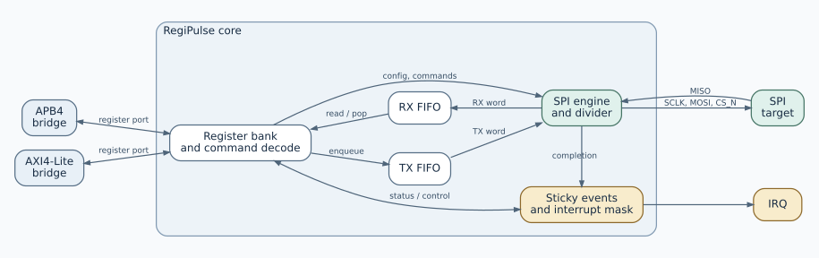
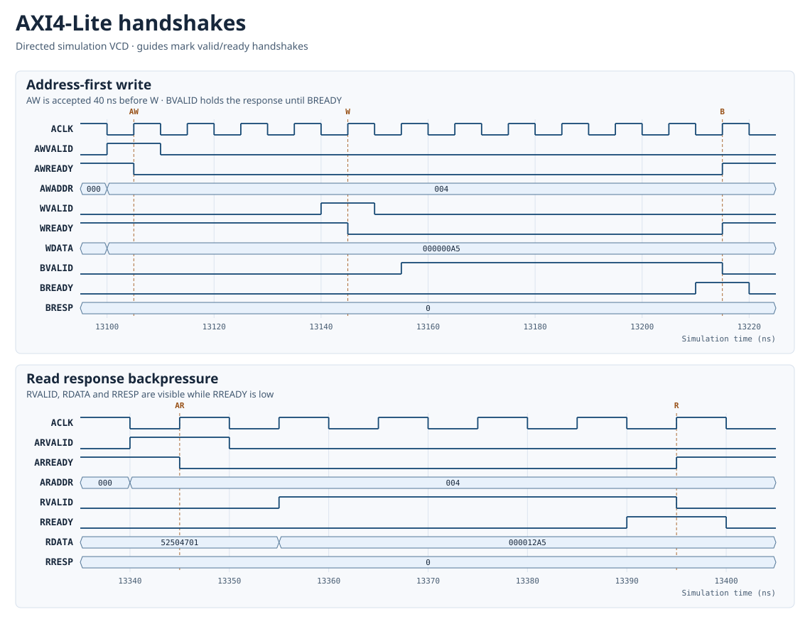
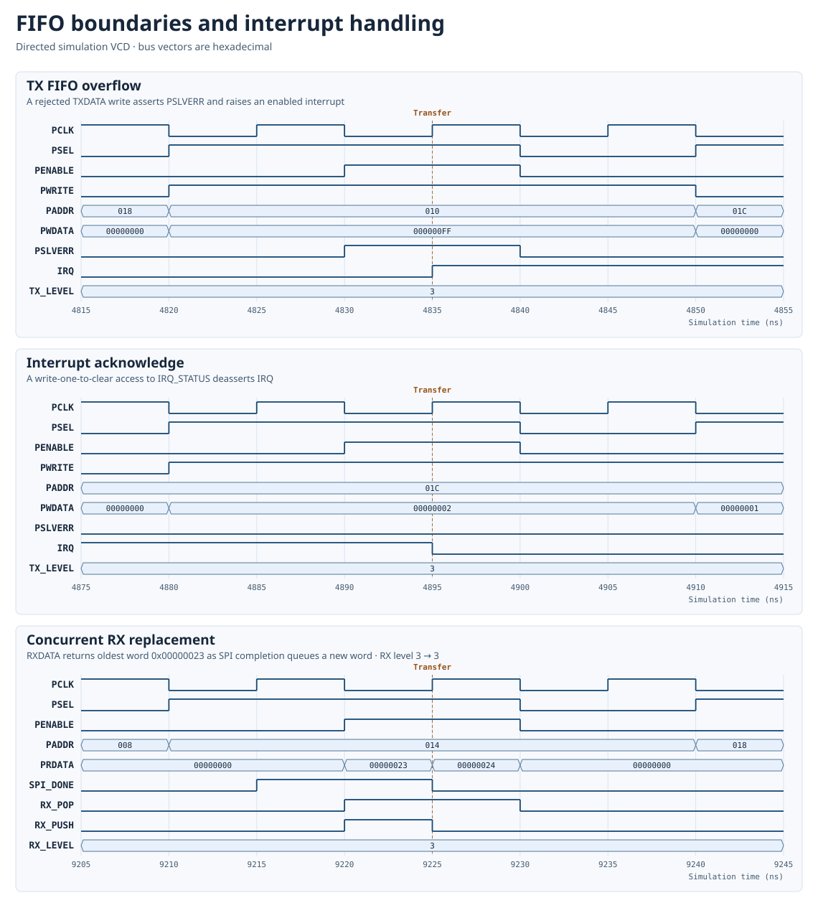

# RegiPulse

ASIC IP Design and Pre-Silicon Verification

RegiPulse is a configurable SPI master peripheral for SoC integration, developed in SystemVerilog. It supports two bus interfaces, APB4 and AXI4-Lite, using the same SPI core and register map.

The project is currently in development. The RTL and initial verification are implemented.

## Architecture



The design contains a bus interface, a register bank, TX and RX FIFOs, an SPI engine and an interrupt controller.

### Main features

- Full-duplex SPI communication with modes 0, 1, 2 and 3.
- Configurable frame size from 1 to 32 bits and MSB-first or LSB-first transmission.
- Programmable SPI clock divider and 1 to 16 chip selects.
- Separate 32-bit TX and RX FIFOs, configurable from 1 to 255 entries each.
- Interrupts for transfer completion, FIFO errors, invalid accesses and aborted transfers.
- APB4 zero-wait-state accesses and independent AXI4-Lite read and write channels with backpressure support.

One START command transfers one word from the TX FIFO. The received word is stored in the RX FIFO. An active transfer can be aborted without clearing the remaining queued data.

## Register map

| Offset | Register | Access | Description |
| --- | --- | --- | --- |
| 0x00 | CTRL | RW | SPI mode, frame size, bit order and chip select |
| 0x04 | DIV | RW | SPI clock divider |
| 0x08 | CMD | WO | Start, abort and FIFO flush |
| 0x0C | STATUS | RO | Busy and FIFO status |
| 0x10 | TXDATA | WO | Write data to TX FIFO |
| 0x14 | RXDATA | RO | Read and pop data from RX FIFO |
| 0x18 | LEVEL | RO | FIFO entry counts |
| 0x1C | IRQ_STATUS | W1C | Pending interrupt flags |
| 0x20 | IRQ_ENABLE | RW | Interrupt enable bits |
| 0x24 | ID | RO | Peripheral identification |

RW: read/write, RO: read-only, WO: write-only, W1C: write one to clear.

## Verification

The RTL is tested using self-checking SystemVerilog testbenches, an independent SPI slave model and SystemVerilog Assertions (SVA). An initial UVM environment includes an APB agent, sequencer, driver, monitor and scoreboard.

| Check | Result |
| --- | --- |
| Verilator lint | Passed for both bus interfaces |
| FIFO component tests | Passed at depths 1, 3 and 255 |
| SPI component tests | 10 frames passed, including maximum divider |
| Directed integration tests | 13 scenarios passed on Verilator and Icarus |
| SVA | 12 properties checked with Verilator |
| UVM smoke test | 13 APB transactions, 1 SPI frame, 0 errors and 0 fatals |
| Yosys structural checks | 0 problems reported for both wrappers |

The directed tests cover the four SPI modes, bus transactions, FIFO boundaries, interrupt handling, AXI backpressure, abort and reset during a transfer.

The UVM and Yosys results are recorded development results. GitHub Actions currently runs lint and the directed RTL tests with both simulators.

### Simulation waveforms






## Tools

SystemVerilog, UVM 2020.3.1, Verilator 5.048, Icarus Verilog 12.0, Yosys, Python, GNU Make and GitHub Actions. The flow uses free and open-source tools.

## Run the tests

The provided setup targets x86-64 Linux (Debian 13). From the repository root:

```sh
./scripts/install_simulators.sh
export PATH="$PWD/.toolchain/bin:$PATH"
make check
make test-iverilog
make waves
```

Run the UVM smoke test with `make uvm`. With Yosys installed and available on PATH, run `make structural`.

Simulation logs and generated waveforms are saved in `build/`.

## Project structure

```text
rtl/            SystemVerilog design
assertions/     SVA properties
tests/          RTL testbenches
verification/   UVM environment
scripts/        Setup and simulation scripts
docs/           Design and verification documentation
reports/        Development results
assets/         Architecture and simulation diagrams
```

## Next steps

- Extend UVM verification to AXI4-Lite and SPI, with randomized tests.
- Measure functional and code coverage, and add formal verification.
- Develop an embedded C driver and test it with the RTL.
- Perform technology mapping, gate-level simulation and scan testing.
- Explore SKY130 physical implementation and measure timing, power and area.

## License

Apache License 2.0.
