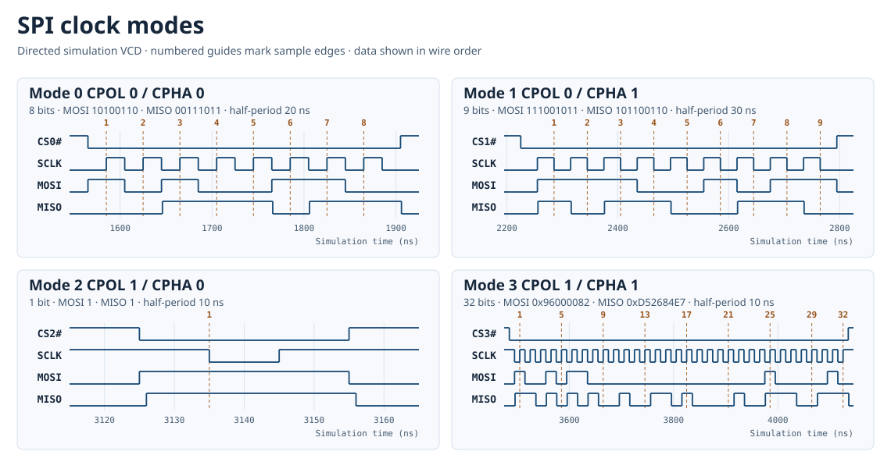

# RegiPulse — ASIC IP Design & Pre-Silicon Verification

RegiPulse is a synthesizable, full-duplex SPI master for SoCs. Integrate
`regipulse_apb` on APB4 or `regipulse_axil` on AXI4-Lite. Both wrappers use
the same register bank, FIFOs, interrupt logic and serial engine.

## Development status

Phase 1 delivers the RTL foundation and its initial verification. See the
[milestone tracker](reports/milestones.md) for measured results and the
remaining work.

## Architecture


- Four SPI modes, 1–32 bits per frame, either bit order and 1–16 chip selects.
- Programmable clock half-period of 1–65,536 peripheral clock cycles.
- Independent 32-bit TX and RX FIFOs with configurable depth of 1–255 entries.
- Sticky interrupt status, write-one-to-clear events, per-source enables and
  detection of queue errors, invalid accesses and rejected commands.
- AXI4-Lite accepts address and data independently. Read and write responses
  have independent backpressure. APB4 uses zero-wait-state register accesses.

One `START` transfers one queued word and asserts the configured chip select
for that frame. `ABORT` terminates an active transfer and preserves queued
data. See the [specification](docs/specification.md) and
[integration details](docs/architecture.md) for timing and reset behavior.

## Register map

| Offset | Register | Access | Purpose |
| --- | --- | --- | --- |
| `0x00` | `CTRL` | RW | SPI mode, bit order, frame length and chip select |
| `0x04` | `DIV` | RW | SCLK half-period in peripheral clock cycles minus one |
| `0x08` | `CMD` | WO | Start, flush either FIFO or abort |
| `0x0c` | `STATUS` | RO | Busy and FIFO flags |
| `0x10` / `0x14` | `TXDATA` / `RXDATA` | WO / RO | Push TX or pop RX |
| `0x18` | `LEVEL` | RO | TX and RX entry counts |
| `0x1c` / `0x20` | `IRQ_STATUS` / `IRQ_ENABLE` | W1C / RW | Pending events and masks |
| `0x24` | `ID` | RO | Peripheral and register-map revision ID |

The [register map](docs/register-map.md) defines field encodings, byte strobes
and error responses.

## Verification

Component tests exercise FIFO boundary depths and SPI edge timing. The
integration test drives both bus interfaces and compares the serial data to
an independent SPI slave model. Verilator enables bound assertions for
completion, reset, IRQ priority and AXI response stability. The UVM smoke
uses an APB sequencer, driver, monitor and scoreboard with the simulated RTL.



See the [verification plan](docs/verification-plan.md) and
[requirements matrix](docs/traceability.md).

The component bench checks FIFO depths 1, 3 and 255, 10 SPI frames and the
maximum divider. Verilator and Icarus passed 13 integration scenarios covering
FIFO edge races, concurrent AXI channels and reset during a transfer.
The UVM smoke passed 13 APB transfers and one independently checked SPI frame
with zero UVM errors or fatals.
Yosys elaboration and structural checks reported zero problems for both
wrappers. The [milestone tracker](reports/milestones.md) records the tool
versions and results.

## Reproduce

```sh
./scripts/install_simulators.sh
export PATH="$PWD/.toolchain/bin:$PATH"
make check
make test-iverilog
make waves
```

Use `make uvm` for the Accellera smoke and `make structural` for the Yosys
RTL checks. The [toolchain guide](docs/toolchain.md) pins dependencies and
describes simulator support.

## Remaining milestones

The full UVM regression, coverage closure, formal verification, embedded C
driver and RTL co-simulation are pending. The ASIC flow still needs
technology mapping, gate-level simulation, scan, physical implementation
and measurements for timing, power and area.
