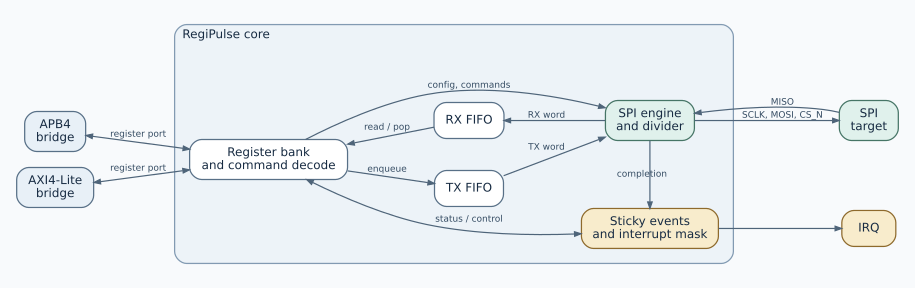

# Hardware architecture

Choose `regipulse_apb` for APB4 or `regipulse_axil` for AXI4-Lite. Each top
wraps the same peripheral core and uses the same 32-bit [register map](register-map.md).

Regenerate the diagram from its Graphviz source with
`dot -Tsvg assets/architecture.dot -o assets/architecture.svg` at the repository root.

Both variants share a 32-bit, byte-enabled, single-request register interface.
Each asserted request is sampled on `clk_i`. Reads and error responses are
combinational in the request cycle. Access side effects, such as dequeuing
`RXDATA`, commit at that cycle’s rising edge. The core evaluates the full
peripheral-relative address and accepts aligned, mapped offsets only. SoC
interconnect supplies the address offset within the peripheral aperture.

| Parameter | Default | Supported values |
| --- | --- | --- |
| `ADDR_WIDTH` | 12 | 6 bits or greater |
| `FIFO_DEPTH` | 8 | 1–255 words in each of the TX and RX FIFOs |
| `NUM_CS` | 4 | 1–16 active-low chip-select outputs |

## Bus timing

**APB4.** `PREADY` is tied high. The core sees a request only during the access
phase, when `PSEL` and `PENABLE` are both high and reset is released. The
bridge signals `PSLVERR` in that same phase for a rejected access. A master
must include a setup phase before each access, including consecutive
transfers to RegiPulse. The zero-wait path puts address decode and the read
data multiplexer on the APB response timing path.

**AXI4-Lite.** The bridge accepts write address and data independently, in
either order. It issues a write once both halves are buffered. It also buffers
one read address. When both directions are eligible, the direction opposite
the last grant wins, with writes preferred after reset. It registers the result
as `OKAY` or `SLVERR` and holds the response and any read data until the host
accepts it. Backpressure on a response blocks further requests of that
direction. The other direction can continue independently. The bridge applies
identical permissions for all `AxPROT` values.

The AXI4-Lite design allows one outstanding read and one outstanding write.
The limited buffering simplifies response ownership and keeps register side
effects independent of response stalls. A bus master that needs ordering
between channels must wait for the prior operation’s response before issuing
the dependent request.

## SPI and queue timing

The SPI engine runs in the peripheral clock domain. The divider advances a
counter, and terminal counts update the SCLK output and trigger MOSI launch
or MISO sampling. Each SCLK half-period is `DIVIDER + 1` peripheral cycles.
The selected chip stays active for one half-period before the first SCLK edge
and one half-period after the last. A frame latches the configured polarity,
phase, bit order and divider when started. The engine transfers the indicated
1–32 bits from the low end of the TX word and returns a right-aligned RX
word.

The peripheral starts one frame per accepted `START` and asserts chip
select for that frame. A ring buffer in each direction holds data across frame
boundaries. The buffers use an occupancy count and explicit pointer wrap for
non-power-of-two depths. A full buffer can accept a new word in the same
cycle as a successful pop. An empty buffer permits a push alongside a pop
request, with no read-through. Buffer reset and flush initialize the queue
control state, and empty reads return zero.

Reset is active low and sampled on the rising edge of `clk_i`. Hold reset
low across a rising edge before issuing transactions. Reset removes queued
data, clears AXI requests and responses, and returns the serial pins to the
reset configuration. An accepted `ABORT` terminates only the in-flight
frame, deasserts chip select, restores the configured SCLK idle level and
sets `ABORTED`.

SoC integration must constrain SPI pin timing against the selected divider
and target timing. The target must present stable MISO before the peripheral
clock edge that generates the configured SPI sampling edge. Allow for SCLK
output delay, target clock-to-data delay, board propagation and MISO input
setup time when choosing the divider.
